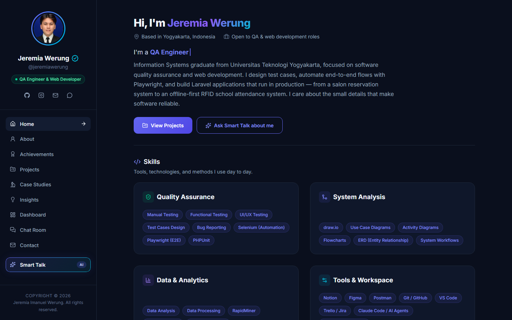
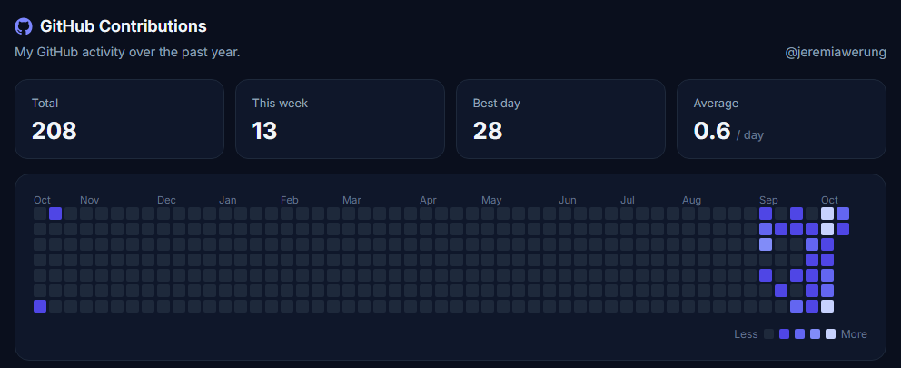
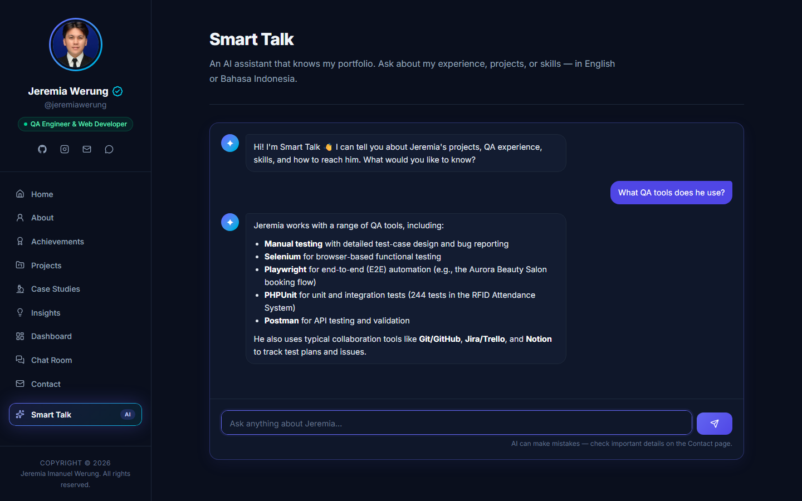
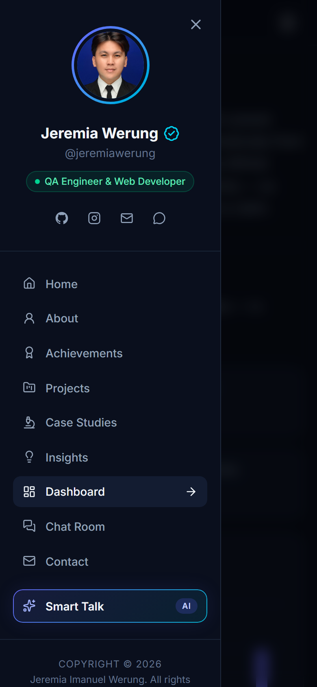

# Jeremia Imanuel Werung — Portfolio

**QA Engineer & Web Developer** · Yogyakarta, Indonesia

🌐 **Live:** [jeremiawerung.my.id](https://jeremiawerung.my.id)


Most portfolios only show the finished work. This one also shows the **process**: a live dashboard pulls real data from GitHub, WakaTime, and the site's own traffic, so visitors see actual numbers instead of claims. Visitors can also leave a message in a public chat room or ask an AI assistant about my experience.



## Features

| Page | What it does |
|---|---|
| **Home · About · Achievements** | Introduction, skills, career timeline, education, and certificates |
| **Projects · Case Studies** | Production web apps and in-depth QA case studies (test cases, bug reports, Playwright automation) |
| **Insights** | Articles and curated software-testing resources |
| **Dashboard** | Live site analytics, GitHub contributions heatmap, and WakaTime coding stats |
| **Chat Room** | Public guestbook-style chat with near real-time updates and admin moderation |
| **Smart Talk** | AI assistant that answers questions about my work, grounded in my portfolio content |

### Live dashboard



- **Site analytics, built in-house.** No cookies, no third-party scripts, and no raw IP addresses stored: each visitor is counted using a daily-rotating salted hash. Bots and my own admin visits are excluded.
- **GitHub contributions.** Uses the public contribution calendar, or the official GraphQL API when a token is configured.
- **WakaTime.** Shows the last 7 days of coding activity and all-time totals. The section hides itself when no API key is set.
- **No cron needed.** External data is cached and refreshed on demand. If an API is down, the dashboard shows the last good data instead of an empty state.

### Smart Talk



- Works with any OpenAI-compatible API (default: Groq, `openai/gpt-oss-120b`). The provider is changed through `.env` only.
- The system prompt contains only public portfolio facts, and the assistant declines off-topic or prompt-injection requests.
- Limited per visitor (per minute and per day) and with a global daily cap to protect the free quota.
- Replies are rendered with a tiny safe Markdown subset built from DOM nodes. `innerHTML` is never used.

### Chat Room

- Visitors only need a name. Spam protection includes a honeypot field, link blocking, duplicate detection, and rate limiting.
- The admin (me) replies with an **Author** badge and can delete messages. The admin login is hidden from navigation and throttled.

<p align="center"></p>

## Quality & security

This is a QA portfolio, so the site is tested like one:

- **45 feature tests (PHPUnit)** cover every page, chat validation and moderation, rate limits, XSS stripping, the honeypot, AI error handling, daily caps, dashboard caching and fallbacks, analytics bot filtering, and admin authentication.
- External HTTP calls are faked in tests (`Http::fake` + `preventStrayRequests`), and tests run against an in-memory SQLite database.
- Security basics are covered:
  - CSRF on every write
  - server-side validation and `strip_tags`
  - Eloquent only, no raw SQL with user input
  - Blade escaping and `textContent` rendering
  - `is_admin` guarded from mass assignment
  - custom error pages with no debug output
  - HTTPS enforced in production
  - secrets only in `.env`

```bash
php artisan test
```

## Tech stack

- **Backend:** Laravel 12, PHP 8.4, SQLite
- **Frontend:** Blade, Tailwind CSS 4, vanilla JavaScript (ES modules via Vite), Lucide icons
- **Charts:** plain HTML/CSS (no chart library), with colors checked for color-vision deficiency
- **Integrations:** GitHub, WakaTime API, Groq (OpenAI-compatible)
- **Hosting:** cPanel shared hosting, deployed over SSH

## Run it locally

Requirements: PHP 8.4+, Composer, Node.js 20+.

```bash
git clone https://github.com/jeremiawerung/Portofolio-Jeremia-Imanuel-Werung.git
cd Portofolio-Jeremia-Imanuel-Werung

composer install
npm install

cp .env.example .env
php artisan key:generate
touch database/database.sqlite
php artisan migrate

npm run build
php artisan serve
```

Optional settings in `.env`:

| Variable | Purpose |
|---|---|
| `SMART_TALK_API_KEY` | Enables Smart Talk (for example a Groq API key) |
| `SMART_TALK_BASE_URL` / `SMART_TALK_MODEL` | Switch to another OpenAI-compatible provider or model |
| `WAKATIME_API_KEY` | Shows the WakaTime section on the dashboard |
| `GITHUB_TOKEN` | Uses the official GitHub GraphQL API instead of the public calendar |

Create the admin account for Chat Room moderation:

```bash
php artisan portfolio:make-admin
```

## Project structure

```
app/Http/Controllers   Dashboard, Chat Room, Smart Talk, admin auth
app/Services           GitHub, WakaTime, analytics, AI client
resources/views/pages  One Blade view per page (+ partials)
resources/js/pages     Dashboard charts, chat polling, Smart Talk UI
resources/ai           Smart Talk knowledge and rules
tests/Feature          45 feature tests
```

## Contact

- Email: [jeremia07102004@gmail.com](mailto:jeremia07102004@gmail.com)
- Instagram: [@jeremia.werung](https://instagram.com/jeremia.werung)
- Or say hi in the [Chat Room](https://jeremiawerung.my.id/chat-room)

---

© 2026 Jeremia Imanuel Werung
